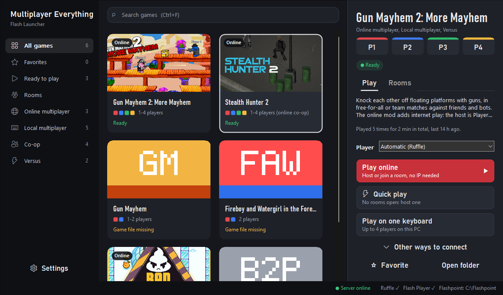

<h1 align="center">Multiplayer Everything Launcher</h1>

<p align="center"><b>We make multiplayer mods for games that never had one. This is the app that installs them and gets you into a room with friends.</b></p>

<p align="center">
<a href="https://discord.gg/jnnyz2vqB5"></a>
<a href="https://multiplayereverything.com"></a>
<a href="https://github.com/multiplayereverything/multiplayer-mods-launcher/releases/latest"></a>
</p>

<p align="center">
<a href="#quick-start">Quick start</a> ·
<a href="#how-it-works">How it works</a> ·
<a href="#what-it-does">What it does</a> ·
<a href="#games">Games</a> ·
<a href="#command-line">Command line</a> ·
<a href="#build">Build</a> ·
<a href="#repository">Repository</a>
</p>

Multiplayer Everything makes multiplayer mods for games that never had multiplayer before. Open the launcher, pick a game, and
press **Play online**. For the **Flash games** it starts them in Ruffle or Flash Player with
the right file and settings, and you join a room with a code: no IP addresses, no port
forwarding. For the **PC game mods** (Spooky Together and more to come) it finds your copy
of the game, installs the mod into it, keeps it up to date, and can take it out again,
putting back every game file it replaced. Native C++20/Win32, no dependencies, and the
whole app is one `.exe`.

Questions, bugs, or looking for people to play with? Join the [Multiplayer Everything Discord](https://discord.gg/jnnyz2vqB5).



Games available now: **Gun Mayhem 2** · **Stealth Hunter 2** · **Bad Ice-Cream** ·
**Territory War** · **Bow Man** · **Ultimate Crab Battle** · **Air Battle** · **Raft Wars** ·
PC mod: **Spooky Together** (**Baldi Together** coming soon). Full list under [Games](#games).

## Quick start

1. Download `MultiplayerEverythingLauncher.exe` from [Releases](https://github.com/multiplayereverything/multiplayer-mods-launcher/releases/latest)
   (or the `.zip` with the editable `launcher.json` and covers next to it) and put it in
   its own folder: game files are saved in a `games\` folder beside it.
2. Run it. If no Flash player is found it offers to install Ruffle; say yes.
3. Set your name in Settings once (Ctrl+,).
4. **Flash game:** select it and press *Play online*, or *Quick play* to join the busiest
   open room. **PC mod:** select it and press *Install*, then *Launch*.

More detail: [Playing a Flash game](#playing-a-flash-game) and [PC game mods](#pc-game-mods).

## How it works

| | Flash games | PC game mods |
|---|---|---|
| What the launcher does | Finds Ruffle or Flash Player and the game's `.swf`, builds the exact command line, starts it, watches it exit | Finds the game, downloads the mod's package, installs it into the game's folder, keeps it updated |
| Online play | Rooms with a code on the central server; direct IP through the built-in relay (Radmin, LAN, Tailscale) | The mod connects through the same central server |
| Safety | Checksums on every download (Ruffle, game files, the launcher itself) | One all-or-nothing install with a SHA-256 check; backups of replaced files; Uninstall restores the game |
| Where it's configured | `launcher/launcher.json` | the game's `mod` object in `launcher/launcher.json` |
| Guide | [CONFIG.md](CONFIG.md) | [docs/MOD_PACKAGES.md](docs/MOD_PACKAGES.md) |

A new game or mod never needs a code change: everything lives in `launcher.json`
(also built into the exe, so the exe is all you need to send someone).

## What it does

- **Installs PC game mods safely.** Pick a mod, press *Install*: the launcher finds
  the game (Steam, Epic, registry, or a folder you choose), downloads the mod's
  package, checks it against its SHA-256 and copies it in as one all-or-nothing
  transaction. Cancel, an error or a crash undoes every change; files the mod
  replaces are backed up first; your edited settings files are kept on update.
  *Update*, *Repair* and *Uninstall* work the same way, and a mod installed earlier by
  its stand-alone setup is recognised as installed. Mods are installed per game and
  need the game closed.
- **Finds everything itself.** Ruffle (its own `players\` folder, `Program Files`,
  PATH), Flashpoint's Flash Player 32, and each game's `.swf` in `games\` or your
  Flashpoint folder. Anything missing gets a button that fixes it: *Locate game
  file...* or *Install Ruffle*.
- **Installs Ruffle for you.** With no Flash player on the PC, the launcher offers
  to install Ruffle: it downloads the latest stable release from Ruffle's official
  GitHub page, checks it against the published SHA-256 checksum, and unpacks it
  into `players\ruffle\`. Nothing is downloaded without your OK.
- **Player slots.** Every game shows how many players it takes, in the players'
  own colors (P1 red, P2 blue, P3 green, P4 yellow). While you host, the slots fill
  with the names of the people who joined.
- **Online first.** Online games lead with *Play online*: rooms with a code on the
  Multiplayer Everything central server, no IP addresses and no port forwarding.
  *Quick play* joins the busiest open room, or starts the game ready to host when
  none is open. Direct IP (Radmin, LAN) is still there under *Other ways to connect*.
- **Rooms.** The *Rooms* page in the sidebar lists every open room of every game
  (filter by game, hide full rooms, search), with the number of players online next
  to it. Each online game also has a *Rooms* tab. *Join* (or *Join by code*) copies
  the code and starts the game with it; mods that read it join by themselves,
  otherwise paste it in the game's F9 panel. The bottom bar shows whether the server
  answers and how fast. Lists refresh every 30 seconds.
- **Updates itself.** At start the launcher checks the newest release here; when
  there is a newer one it downloads `MultiplayerEverythingLauncher.exe`, checks it against the
  SHA-256 GitHub publishes for it, swaps it in and offers to restart (while a game
  runs, it just starts next time). Settings can turn it off; `--update` does it now.
- **One file.** `launcher.json` and the cover images are built into
  `MultiplayerEverythingLauncher.exe`, so the exe is all you need to send someone. A `launcher.json`
  or `covers\` folder next to the exe still wins, for your own changes.
- **Game updates.** When a newer build of a downloaded game file is published, the
  card says *Update available* and the details panel offers *Update game files*.
- **Settings.** Your name for online rooms, minimize while playing, default player,
  showing offline play (solo and one keyboard, off by default) and the original
  (unmodded) versions, online features on or off, automatic updates, where game
  files are kept, and the log folder (button at the bottom of the sidebar, or Ctrl+,).
- **Discord.** With a Discord application id in `launcher.json`, Discord shows what
  you are playing and the room code (off until an id is set).
- **Calm motion.** A short entrance when the window opens, cards that lift under
  the mouse, open player slots that breathe while you host. All of it follows
  Windows' *Animation effects* setting.
- **Hosting without extra windows.** *Host online* starts a built-in relay (the
  same protocol as the mods' `gm2_relay.py` / `sh2_relay.py`, so no Python is
  needed) and shows who is connected plus the addresses friends should type,
  including VPN adapters such as Radmin VPN, ZeroTier or Tailscale.
- **Smooth.** One native process. Games run in their own player process; the
  launcher only watches them, so it never slows a match down. The game grid is a
  double-buffered list with art pre-scaled once per size.
- **Keeps track.** Favorites, play count, play time, last played, and which
  player you prefer per game.
- **Everything in `launcher.json`.** Games, actions, players, colors and every
  visible string. Adding a game needs no C++ (see [CONFIG.md](CONFIG.md)).

## Games

| Game | Actions | Notes |
|---|---|---|
| Gun Mayhem 2: More Mayhem | Play online, Quick play, Play on one keyboard | Up to 4 players, with the Gun Mayhem 2 Online mod. Direct IP: relay port 7777. |
| Stealth Hunter 2 | Play online, Quick play, Play solo | The Stealth Hunter 2 Online mod adds co-op for up to 4. Runs in Ruffle only. Direct IP: relay port 7778. |
| Bad Ice-Cream | Play online, Quick play, Play on one keyboard | Two players, with the Bad Ice-Cream Online mod (Nitrome's game). |
| Territory War | Play online, Quick play | Red against blue on up to 4 PCs. |
| Bow Man | Play online, Quick play | Two archers on two PCs. Ruffle only. |
| Ultimate Crab Battle | Play online, Quick play | Co-op for up to 4, one ship each. |
| Air Battle | Play online, Quick play | Co-op for up to 4, one balloon boat each. |
| Raft Wars | Play online, Quick play | Co-op for up to 4, taking turns at the bazooka. |
| Intrusion, Intrusion 2 | | Coming soon: listed, no buttons yet. |

The newer mods are online-only (no direct IP); their single-player modes are under
*Play offline* when Settings shows offline play. Until a mod's file is published in
mods-info, the central server doesn't know the game: its card says *Not on the server
yet* and Quick play is hidden.

More games are on the way; the local-only classics (Gun Mayhem, Fireboy and
Watergirl, Boxhead) are set aside in `docs/local-games-example.jsonc` for now.

The original, unmodded versions of the modded games are hidden; Settings can show
them (*Play the original*).

**Getting the games.** When a game file is missing, the game shows *Download game
files*: the launcher fetches them from [multiplayereverything/flash-games](https://github.com/multiplayereverything/flash-games),
checks each file against the SHA-256 in that repository's catalog, and saves it in
`games\`. That covers every game in the list except the coming-soon ones (the
repository's README lists how far each build is tested). You can also put your own `.swf` files in `games\` (names are in
`games\README.txt`), use *Locate game file...*, or install Flashpoint, whose copies
are picked up automatically.

## PC game mods

Not Flash: installed into the game's own folder.

| Mod | Game | Notes |
|---|---|---|
| Spooky Together | Spooky's Jump Scare Mansion: HD Renovation (Steam) | Co-op for 2 to 4 players, with the BepInEx mod loader. Needs its package published (see [docs/MOD_PACKAGES.md](docs/MOD_PACKAGES.md)). |
| Baldi Together | Baldi's Basics Plus (Steam) | Coming soon: listed, no buttons yet. |

Pick the mod, press *Install*, then *Launch*. *Update*, *Repair* and *Uninstall* sit beside it; the game must be closed. Try it safely from the command line with `--game-dir` on a copy of the game folder. Authors: see [docs/MOD_PACKAGES.md](docs/MOD_PACKAGES.md).

## Playing a Flash game

Flash Player itself can't be installed automatically: Adobe stopped distributing
it, so there is no official download left. Install [Flashpoint](https://flashpointarchive.org/downloads)
if a game needs Flash Player instead of Ruffle (Ruffle is [installed for you](#what-it-does)).

**Hosting:** set your name in Settings once. Select the game, press *Play online*,
then in the game press **F9**, set MODE to ONLINE and click **HOST**. Send friends
the room code it shows; the room also appears in everyone's *Rooms* list.

**Joining:** pick the room on the *Rooms* page or the game's *Rooms* tab and press
*Join* (or type the code under *Join by code*). The code is on your clipboard:
in the game press **F9**, paste it and click **JOIN**, if the game hasn't joined
by itself.

**Direct IP** (*Other ways to connect*): *Host with your IP* starts the built-in
relay and shows the addresses friends type, including Radmin VPN, ZeroTier or
Tailscale. Windows may ask to allow `MultiplayerEverythingLauncher.exe` through the firewall the
first time: allow it, or friends can't connect.

Keyboard: arrow keys move through the grid, **Enter** plays, **Ctrl+F**
searches, **Ctrl+,** opens Settings, **F5** rescans for players and game files,
**Tab** reaches every button.

## Command line

```
MultiplayerEverythingLauncher.exe --list                       every game and whether it can start
MultiplayerEverythingLauncher.exe --launch gunmayhem2:host     start an action without the window
MultiplayerEverythingLauncher.exe --relay 7777                 run only the relay (a dedicated relay PC)
MultiplayerEverythingLauncher.exe --install-player ruffle      install Ruffle into players\ruffle
MultiplayerEverythingLauncher.exe --download-game all          download every game file the catalog has
MultiplayerEverythingLauncher.exe --rooms gunmayhem2           list the open rooms on the central server
MultiplayerEverythingLauncher.exe --update                     install the newest launcher release now
MultiplayerEverythingLauncher.exe --mods                       the PC mods: game found, installed version, newest version
MultiplayerEverythingLauncher.exe --install-mod spooky-together  install or update a PC mod (add --game-dir "<folder>" to point at the game)
MultiplayerEverythingLauncher.exe --repair-mod spooky-together   put back missing or damaged files
MultiplayerEverythingLauncher.exe --uninstall-mod spooky-together  remove it and restore the game's files
MultiplayerEverythingLauncher.exe --validate                   check launcher.json
```

`MultiplayerEverythingLauncher.exe --help` lists everything. Settings and the log live in
`%LOCALAPPDATA%\MultiplayerEverything\FlashLauncher\`.

## Build

Requires Visual Studio 2022 (or Build Tools) with the C++ workload.

```bat
powershell -ExecutionPolicy Bypass -File build.ps1 -Test
powershell -ExecutionPolicy Bypass -File build.ps1 -Dist
```

`-Test` runs the C++ tests (config, file lookup, command lines, settings, and
the relay against real sockets) and `tests\e2e.ps1`, which drives the real exe
and its window through the accessibility API with a fake player, and installs a
fake player and fake game files from a local test server (checksums, failed
reinstall, first-run prompt, the window's download button). `-Dist` makes
`dist\MultiplayerEverythingLauncher\` and its `.zip`, and refuses to package any
`.swf` or player binary; it also copies the single-file `dist\MultiplayerEverythingLauncher.exe`.

## Repository

| Path | Contents |
|---|---|
| `src/core/mod/` | The PC-mod engine (ported from the installer template): game detection, planning, the all-or-nothing install transaction, the install record, package download |
| `src/core/` | No UI: config, library (players, files, command lines), process watching, relay, downloads, rooms, settings, Discord, built-in files |
| `src/ui/` | The launcher window and its theme |
| `src/app/` | Entry point and command line |
| `launcher/` | `launcher.json` and `covers\` (both also built into the exe), `games\`, `players\` |
| `docs/html5-example.jsonc` | HTML5 support (browser players, Plazma Burst 2 co-op), kept out of the shipped list for now |
| `docs/local-games-example.jsonc` | Gun Mayhem, Fireboy and Watergirl, Boxhead: local-only games set aside for now |
| `tests/` | C++ tests and the end-to-end script |
| [CONFIG.md](CONFIG.md) | Every `launcher.json` option |

Ruffle is open source ([ruffle.rs](https://ruffle.rs)). Flash Player and the
games belong to their owners; this project ships neither.

## Made with

This project was made with the help of these tools:

- [antislop-ui](https://github.com/miqdadbadjuber/anti-slop/tree/main/skills/antislop-ui)
- [coop-anything](https://github.com/cranebeaker/coop-anything)
- [REA](https://github.com/morluto/rea)
- [Universal Modder](https://github.com/rehan-remade/universal-modder)
